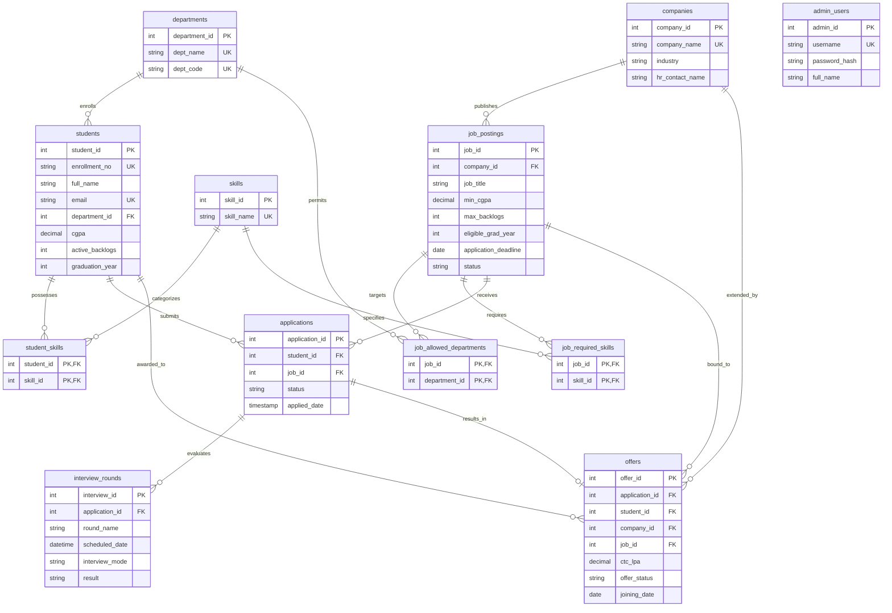

# Campus Placement & Eligibility Management System

A complete, normalized relational database mini-project designed for college academic submissions and viva demonstrations. Built with **MySQL 8**, **Python (Flask)**, **Bootstrap 5**, and **Chart.js**.

---

## Table of Contents

1. [Project Overview & Objectives](#1-project-overview--objectives)
2. [Technology Stack](#2-technology-stack)
3. [System Requirements](#3-system-requirements)
4. [Project Structure](#4-project-structure)
5. [Database Schema & ER Diagram](#5-database-schema--er-diagram)
6. [Normalization Analysis (1NF, 2NF, 3NF)](#6-normalization-analysis)
7. [Setup & Installation Guide](#7-setup--installation-guide)
   - [Step 1: Clone or Navigate to Directory](#step-1-navigate-to-directory)
   - [Step 2: Configure Environment Variables](#step-2-configure-environment-variables)
   - [Step 3: Setup Virtual Environment & Dependencies](#step-3-setup-virtual-environment--dependencies)
   - [Step 4: Initialize and Seed MySQL Database](#step-4-initialize-and-seed-mysql-database)
   - [Step 5: Run the Flask Web Application](#step-5-run-the-flask-web-application)
8. [Demo Login Credentials](#8-demo-login-credentials)
9. [Key Features & Modules](#9-key-features--modules)
   - [Live KPI Dashboard](#live-kpi-dashboard)
   - [Student Management (CRUD)](#student-management-crud)
   - [Company & Job Management](#company--job-management)
   - [Dynamic Eligibility Explorer](#dynamic-eligibility-explorer)
   - [Application & Interview Workflow](#application--interview-workflow)
   - [Single Accepted Offer Policy & Atomic Acceptance](#single-accepted-offer-policy)
   - [Analytics & CSV Reports](#analytics--csv-reports)
   - [Interactive SQL Showcase for Viva](#interactive-sql-showcase-for-viva)
10. [Demonstrated DBMS & SQL Concepts](#10-demonstrated-dbms--sql-concepts)
    - [A. INNER JOIN & LEFT JOIN](#a-inner-join--left-join)
    - [B. GROUP BY & Aggregate Functions](#b-group-by--aggregate-functions)
    - [C. Subqueries & Derived Tables](#c-subqueries--derived-tables)
    - [D. MySQL Views](#d-mysql-views)
    - [E. Stored Procedures](#e-stored-procedures)
    - [F. Triggers](#f-triggers)
    - [G. ACID Transactions & Rollback](#g-acid-transactions--rollback)
    - [H. Constraints & Indexes](#h-constraints--indexes)
11. [Running Automated Tests](#11-running-automated-tests)
12. [College Viva Voce Questions & Answers](#12-college-viva-voce-questions--answers)
13. [Troubleshooting & FAQs](#13-troubleshooting--faqs)

---

## 1. Project Overview & Objectives

In university placement offices, tracking candidate qualifications across differing criteria (minimum CGPA thresholds, allowable backlogs, eligible branches, and required skill sets) is traditionally prone to human error and data redundancy.

This project delivers a **full-stack, normalized relational database management system** that:
- Centralizes academic profiles, skills, recruiting companies, job openings, and interview rounds.
- Evaluates student eligibility dynamically using server-side logic and database queries rather than hardcoded static flags.
- Enforces relational integrity constraints, preventing duplicate applications or multiple accepted offers.
- Showcases essential DBMS concepts (Joins, Aggregations, Nested Queries, Stored Procedures, Views, Triggers, and ACID Transactions) in an interactive UI designed specifically for viva examination.

---

## 2. Technology Stack

- **Backend:** Python 3.10+ with [Flask 3.0](https://flask.palletsprojects.com/)
- **Database:** [MySQL 8.0+](https://www.mysql.com/)
- **Database Driver:** [PyMySQL](https://pymysql.readthedocs.io/) (pure-Python MySQL client)
- **Frontend / Styling:** HTML5, CSS3, [Bootstrap 5.3](https://getbootstrap.com/), Bootstrap Icons
- **Visualizations:** [Chart.js 4.4](https://www.chartjs.org/)
- **Security:** Werkzeug password hashing (`scrypt`), parameterized SQL statements (`%s` placeholders), session management

---

## 3. System Requirements

- **Operating System:** Windows 10/11, macOS, or Linux
- **Python:** 3.10 or newer (tested on Python 3.13)
- **MySQL:** MySQL Server 8.0+ or MariaDB 10.5+
- **Browser:** Any modern web browser (Chrome, Edge, Firefox, Safari)

---

## 4. Project Structure

```text
DBMS_Project/
├── app.py                      # Application factory and route registration
├── config.py                   # Environment configuration loader
├── db.py                       # PyMySQL connection, transaction, and query helpers
├── init_db.py                  # Automatic database creation and seeding runner
├── requirements.txt            # Python package dependencies
├── .env.example                # Template for database credentials
├── .gitignore                  # Git exclusion rules
├── README.md                   # Complete documentation and viva guide
│
├── database/                   # Pure SQL scripts (executed in strict order)
│   ├── schema.sql              # 12 relational tables, PKs, FKs, CHECKs, INDEXes
│   ├── views.sql               # 4 MySQL Views (placement summaries, flattened views)
│   ├── procedures.sql          # 3 Stored Procedures (reporting, eligibility, offer acceptance)
│   ├── triggers.sql            # 5 Triggers (duplicate prevention, single accepted offer)
│   └── seed.sql                # Realistic seed data (4 depts, 25 students, 6 companies, 7 jobs, etc.)
│
├── services/                   # Business and domain services
│   ├── auth_service.py         # Admin authentication and password verification
│   ├── eligibility_service.py  # Core multi-rule candidate eligibility engine
│   └── dashboard_service.py    # Live SQL aggregate calculations for KPI cards and charts
│
├── routes/                     # Modular Flask Blueprints
│   ├── auth_routes.py          # /login, /logout
│   ├── dashboard_routes.py     # / (main dashboard)
│   ├── student_routes.py       # /students (CRUD, pagination, filters, view profile)
│   ├── company_routes.py       # /companies (CRUD, recruiter details, jobs list)
│   ├── job_routes.py           # /jobs (CRUD, allowed departments, required skills)
│   ├── application_routes.py   # /applications (submission, stage tracking)
│   ├── interview_routes.py     # /interviews (scheduling, round results, feedback)
│   ├── offer_routes.py         # /offers (issuance, atomic acceptance)
│   ├── eligibility_routes.py   # /eligibility (interactive candidate evaluation)
│   ├── report_routes.py        # /reports (analytics and CSV exports)
│   └── showcase_routes.py      # /showcase (live SQL demo for college viva)
│
├── static/                     # Static styling and client assets
│   ├── css/style.css           # Custom university portal stylesheet
│   └── js/main.js              # Sidebar toggle, table filtering, Chart.js wrappers
│
├── templates/                  # Jinja2 HTML templates
│   ├── base.html               # Base layout with sidebar, navbar, flash messages
│   ├── auth/login.html         # Admin login screen
│   ├── dashboard/index.html    # Dashboard with KPI cards and Chart.js graphs
│   ├── students/               # index.html, form.html, view.html
│   ├── companies/              # index.html, form.html, view.html
│   ├── jobs/                   # index.html, form.html, view.html
│   ├── applications/           # index.html, form.html, view.html
│   ├── interviews/             # form.html
│   ├── offers/                 # index.html, form.html
│   ├── eligibility/            # explorer.html
│   ├── reports/                # index.html
│   ├── showcase/               # index.html (SQL demo & Mermaid diagram)
│   └── errors/                 # 404.html, 500.html
│
└── tests/                      # Automated test suite
    ├── test_eligibility_logic.py # Unit tests for eligibility criteria
    ├── test_validation.py        # Unit tests for CGPA, backlog, and field validation
    ├── test_auth_logic.py        # Unit tests for Werkzeug hashing
    └── test_app.py               # Route protection and HTTP status integration tests
```

---

## 5. Database Schema & ER Diagram

The database schema comprises **12 normalized relational tables**:



### Table Details & Foreign Key Policies

| # | Table Name | Purpose | Foreign Keys & Actions | Key Constraints |
|---|------------|---------|------------------------|-----------------|
| 1 | `departments` | Academic departments | None | `dept_name` UNIQUE, `dept_code` UNIQUE |
| 2 | `students` | Student academic profiles | `department_id` &rarr; `departments` (RESTRICT) | `enrollment_no` UNIQUE, `email` UNIQUE, `CHECK(cgpa BETWEEN 0 AND 10)`, `CHECK(active_backlogs >= 0)` |
| 3 | `skills` | Catalog of technical skills | None | `skill_name` UNIQUE |
| 4 | `student_skills` | Junction: student skills | `student_id` (CASCADE), `skill_id` (CASCADE) | Composite PK `(student_id, skill_id)` |
| 5 | `companies` | Recruiting organizations | None | `company_name` UNIQUE |
| 6 | `job_postings` | Placement drives | `company_id` &rarr; `companies` (RESTRICT) | `CHECK(min_cgpa BETWEEN 0 AND 10)`, `CHECK(max_backlogs >= 0)` |
| 7 | `job_allowed_departments` | Junction: eligible branches | `job_id` (CASCADE), `department_id` (CASCADE) | Composite PK `(job_id, department_id)` |
| 8 | `job_required_skills` | Junction: mandatory skills | `job_id` (CASCADE), `skill_id` (CASCADE) | Composite PK `(job_id, skill_id)` |
| 9 | `applications` | Student job applications | `student_id` (RESTRICT), `job_id` (RESTRICT) | UNIQUE `(student_id, job_id)` prevents duplicate applications |
| 10 | `interview_rounds` | Interview assessment rounds | `application_id` &rarr; `applications` (CASCADE) | UNIQUE `(application_id, round_name)` |
| 11 | `offers` | Compensation packages | `application_id`, `student_id`, `company_id`, `job_id` (RESTRICT) | UNIQUE `(application_id)` enforces 1 offer per application |
| 12 | `admin_users` | Admin credentials | None | `username` UNIQUE |

---

## 6. Normalization Analysis

The database is normalized up to **Third Normal Form (3NF)**:

### First Normal Form (1NF)
- Every table has a primary key.
- All column values are atomic (no repeating groups, comma-separated lists, or arrays).
- Rather than storing multiple skills as `"Python, SQL, Java"` inside `students`, the normalized junction table `student_skills` links `(student_id, skill_id)` atomically. Similarly, branch eligibility and skill requirements are modeled in `job_allowed_departments` and `job_required_skills`.

### Second Normal Form (2NF)
- The schema is in 1NF.
- Every non-key attribute is fully functionally dependent on the entire candidate key.
- In junction tables with composite primary keys such as `student_skills (student_id, skill_id)`, there are no partial dependencies because there are no non-key columns depending on only part of the composite key.

### Third Normal Form (3NF)
- The schema is in 2NF.
- There are no transitive functional dependencies ($X \to Y \to Z$).
- For example, `students` stores `department_id` rather than duplicating `dept_name` and `dept_code`. If department information were stored inside `students`, an update to a department name would require updating every student record (update anomaly). Moving it to `departments` ensures non-key attributes depend solely on the primary key.

---

## 7. Setup & Installation Guide

### Step 1: Navigate to Directory

Open PowerShell or Terminal and change to the project directory:
```powershell
cd C:\Users\Dell\Desktop\DBMS_Project
```

### Step 2: Configure Environment Variables

Copy `.env.example` to `.env`:
```powershell
Copy-Item .env.example .env
```
Open `.env` and verify your MySQL connection details:
```env
SECRET_KEY=placement-secret-key-2026
MYSQL_HOST=localhost
MYSQL_PORT=3306
MYSQL_USER=root
MYSQL_PASSWORD=your_mysql_password
MYSQL_DB=campus_placement
```

### Step 3: Setup Virtual Environment & Dependencies

Create and activate a virtual environment (optional but recommended):
```powershell
python -m venv venv
.\venv\Scripts\Activate.ps1
```

Install required packages:
```powershell
python -m pip install -r requirements.txt
```

### Step 4: Initialize and Seed MySQL Database

Make sure your MySQL server is running, then run the automated database setup script:
```powershell
python init_db.py
```

This runs the SQL scripts in the required dependency order:
1. `database/schema.sql`: Creates database and 12 relational tables
2. `database/views.sql`: Creates MySQL analytical views
3. `database/procedures.sql`: Creates stored procedures
4. `database/triggers.sql`: Creates business rule triggers
5. `database/seed.sql`: Populates realistic departments, 25 students, 6 companies, 7 jobs, 20 applications, interviews, and offers
6. Seeds the default admin account with a secure Werkzeug `scrypt` password hash.

Alternatively, execute them in MySQL Workbench or the MySQL CLI in the same order:
```sql
source database/schema.sql;
source database/views.sql;
source database/procedures.sql;
source database/triggers.sql;
source database/seed.sql;
```

### Step 5: Run the Flask Web Application

Start the development server:
```powershell
python app.py
```
Open your browser and navigate to:
```text
http://127.0.0.1:5000
```

---

## 8. Demo Login Credentials

The seed data provisions an administrative account:

| Role | Username | Password | Access Level |
|------|----------|----------|--------------|
| **System Administrator** | `admin` | `admin123` | Full Administrative Access |

> **Security Note:** Passwords are never stored in plaintext. They are salted and hashed using Werkzeug's secure `scrypt` hashing implementation.

---

## 9. Key Features & Modules

### Live KPI Dashboard
- Displays 6 metrics computed directly via SQL:
  - Total Students
  - Registered Companies
  - Active Job Drives
  - Total Candidate Applications
  - Students Placed (Accepted Offers)
  - Students Currently Eligible for at least 1 Active Job
- Interactive Chart.js visualizations:
  - Doughnut chart of applications grouped by status (`Applied`, `Shortlisted`, `Interview`, `Selected`, `Rejected`, `Withdrawn`)
  - Bar chart comparing total students vs. placed students per department
- Quick-access tables for upcoming interviews and recent applications.

### Student Management (CRUD)
- Searchable and paginated student directory with department and graduation year filters.
- Create, view, edit, and delete operations.
- Student profile view displaying academic statistics, registered skills, past applications, interview history, and offers.
- Strict input validation: valid email regex, CGPA constrained to $[0.00, 10.00]$, non-negative backlogs.

### Company & Job Management
- Full lifecycle management for recruiting partners and job postings.
- Foreign-key protected deletion: companies with job postings or students with applications cannot be accidentally deleted (`ON DELETE RESTRICT`), preventing orphan records.
- Configurable job posting parameters: target batch, minimum CGPA, maximum backlogs, eligible departments, and mandatory skills.

### Dynamic Eligibility Explorer
- Dedicated page allowing the placement officer to select any job posting.
- Computes qualified vs. disqualified candidates in real time.
- Displays exact disqualification reasons for ineligible candidates (e.g., *"CGPA 6.10 is below minimum required 7.00"*, *"Missing required skills: Python, SQL"*, *"Department Mechanical Engineering not eligible"*).
- Instant one-click *"Apply"* action for qualifying students.

### Application & Interview Workflow
- Links students to job postings with status progression: `Applied` &rarr; `Shortlisted` &rarr; `Interview` &rarr; `Selected` (or `Rejected` / `Withdrawn`).
- Supports scheduling multiple assessment rounds (`Aptitude`, `Technical`, `Managerial`, `HR`) with interview mode, location details, status, outcome result, and interviewer remarks.

### Single Accepted Offer Policy
- Students may receive multiple offers, but university rules permit at most **one accepted offer**.
- Enforced at both the database level via a trigger (`trg_enforce_single_accepted_offer`) and through the stored procedure `sp_process_offer_acceptance()`.
- Accepting an offer atomically updates the chosen offer to `Accepted`, marks the application as `Selected`, and cascades `Declined` to any other pending offers for that student inside an ACID transaction.

### Analytics & CSV Reports
- Five analytical views:
  1. Department-wise placement percentage and average CTC
  2. Placed students roster with company and package
  3. Company-wise applicant counts and selections
  4. Students without any applications
  5. Recent placement activity stream
- One-click CSV exports with properly formatted and escaped headers and rows.

### Interactive SQL Showcase for Viva
- Built-in demonstration page executing real SQL queries against MySQL and displaying the tabular results alongside syntax-highlighted SQL statements and concise theoretical explanations.
- Interactive Mermaid ER diagram rendering in the browser.

---

## 10. Demonstrated DBMS & SQL Concepts

### A. INNER JOIN & LEFT JOIN

**INNER JOIN Example (Students & Departments):**
```sql
SELECT s.enrollment_no, s.full_name, s.cgpa, d.dept_name, d.dept_code
FROM students s
INNER JOIN departments d ON d.department_id = s.department_id
ORDER BY d.dept_name, s.full_name;
```
*Concept:* Returns only records with matching department keys in both tables.

**LEFT JOIN Example (Students Who Never Applied):**
```sql
SELECT s.enrollment_no, s.full_name, d.dept_name, s.cgpa
FROM students s
INNER JOIN departments d ON d.department_id = s.department_id
LEFT JOIN applications a ON a.student_id = s.student_id
WHERE a.application_id IS NULL
ORDER BY s.full_name;
```
*Concept:* Preserves all rows from the left table (`students`) even when no corresponding record exists in `applications`. Filtering by `WHERE a.application_id IS NULL` identifies unapplied students.

---

### B. GROUP BY & Aggregate Functions

**Department-wise Placement Aggregate:**
```sql
SELECT 
    d.dept_name,
    COUNT(DISTINCT s.student_id) AS total_students,
    COUNT(DISTINCT CASE WHEN o.offer_status = 'Accepted' THEN s.student_id END) AS placed,
    ROUND(AVG(CASE WHEN o.offer_status = 'Accepted' THEN o.ctc_lpa END), 2) AS avg_ctc
FROM departments d
LEFT JOIN students s ON s.department_id = d.department_id
LEFT JOIN applications a ON a.student_id = s.student_id
LEFT JOIN offers o ON o.application_id = a.application_id
GROUP BY d.department_id, d.dept_name;
```
*Concept:* Computes conditional counts (`COUNT(DISTINCT CASE...)`) and averages (`AVG`) grouped by department entity attributes.

---

### C. Subqueries & Derived Tables

**Students with CGPA Above Department Average:**
```sql
SELECT s.enrollment_no, s.full_name, d.dept_name, s.cgpa, dept_avg.avg_cgpa
FROM students s
INNER JOIN departments d ON d.department_id = s.department_id
INNER JOIN (
    SELECT department_id, ROUND(AVG(cgpa), 2) AS avg_cgpa
    FROM students
    GROUP BY department_id
) dept_avg ON dept_avg.department_id = s.department_id
WHERE s.cgpa > dept_avg.avg_cgpa
ORDER BY d.dept_name, s.cgpa DESC;
```
*Concept:* Uses an inline derived table (`dept_avg`) to compute per-department mean CGPA, then joins it back to filter individual students performing above their peer average.

---

### D. MySQL Views

View created in `database/views.sql`:
```sql
CREATE OR REPLACE VIEW vw_placement_summary AS
SELECT
    d.department_id,
    d.dept_name,
    d.dept_code,
    COUNT(DISTINCT s.student_id) AS total_students,
    COUNT(DISTINCT CASE WHEN o.offer_status = 'Accepted' THEN s.student_id END) AS students_placed,
    ROUND(COUNT(DISTINCT CASE WHEN o.offer_status = 'Accepted' THEN s.student_id END) * 100.0 
          / NULLIF(COUNT(DISTINCT s.student_id), 0), 2) AS placement_percentage,
    ROUND(AVG(CASE WHEN o.offer_status = 'Accepted' THEN o.ctc_lpa END), 2) AS avg_ctc_lpa
FROM departments d
LEFT JOIN students s ON s.department_id = d.department_id
LEFT JOIN applications a ON a.student_id = s.student_id
LEFT JOIN offers o ON o.application_id = a.application_id
GROUP BY d.department_id, d.dept_name, d.dept_code;
```
*Concept:* A stored virtual table that pre-aggregates placement metrics across 4 tables for fast, consistent dashboard queries without data duplication.

---

### E. Stored Procedures

Stored procedure created in `database/procedures.sql`:
```sql
DELIMITER $$
CREATE PROCEDURE sp_department_placement_summary()
BEGIN
    SELECT
        d.dept_name AS department,
        COUNT(DISTINCT s.student_id) AS total_students,
        COUNT(DISTINCT CASE WHEN a.application_id IS NOT NULL THEN s.student_id END) AS applied_count,
        COUNT(DISTINCT CASE WHEN a.status = 'Selected' THEN s.student_id END) AS selected_count,
        COUNT(DISTINCT CASE WHEN o.offer_status = 'Accepted' THEN s.student_id END) AS placed_count,
        ROUND(AVG(CASE WHEN o.offer_status = 'Accepted' THEN s.cgpa END), 2) AS avg_cgpa_placed,
        COALESCE(MAX(CASE WHEN o.offer_status = 'Accepted' THEN o.ctc_lpa END), 0) AS highest_ctc_lpa
    FROM departments d
    LEFT JOIN students s ON s.department_id = d.department_id
    LEFT JOIN applications a ON a.student_id = s.student_id
    LEFT JOIN offers o ON o.application_id = a.application_id
    GROUP BY d.department_id, d.dept_name
    ORDER BY d.dept_name;
END$$
DELIMITER ;
```
*Concept:* Encapsulates complex procedural reporting logic on the MySQL server, reducing network round-trips.

---

### F. Triggers

Trigger created in `database/triggers.sql`:
```sql
DELIMITER $$
CREATE TRIGGER trg_prevent_duplicate_application
BEFORE INSERT ON applications
FOR EACH ROW
BEGIN
    DECLARE v_count INT;
    SELECT COUNT(*) INTO v_count
    FROM applications
    WHERE student_id = NEW.student_id AND job_id = NEW.job_id;

    IF v_count > 0 THEN
        SIGNAL SQLSTATE '45000'
            SET MESSAGE_TEXT = 'Duplicate application: This student has already applied for this job.';
    END IF;
END$$
DELIMITER ;
```
*Concept:* Executes automatically before any `INSERT` on `applications`. If a duplicate tuple `(student_id, job_id)` is attempted, it raises `SIGNAL SQLSTATE '45000'` to reject the operation and return a human-readable error.

---

### G. ACID Transactions & Rollback

Procedure `sp_process_offer_acceptance` in `database/procedures.sql`:
```sql
DELIMITER $$
CREATE PROCEDURE sp_process_offer_acceptance(IN p_offer_id INT)
BEGIN
    DECLARE v_student_id INT;
    DECLARE v_application_id INT;
    DECLARE v_current_status VARCHAR(20);

    -- Rollback on any SQL exception
    DECLARE EXIT HANDLER FOR SQLEXCEPTION
    BEGIN
        ROLLBACK;
        RESIGNAL;
    END;

    SELECT student_id, application_id, offer_status
    INTO v_student_id, v_application_id, v_current_status
    FROM offers WHERE offer_id = p_offer_id;

    IF v_current_status <> 'Pending' THEN
        SIGNAL SQLSTATE '45000'
            SET MESSAGE_TEXT = 'Only pending offers can be accepted.';
    END IF;

    START TRANSACTION;

    -- Step 1: Accept chosen offer
    UPDATE offers SET offer_status = 'Accepted' WHERE offer_id = p_offer_id;

    -- Step 2: Mark application as Selected
    UPDATE applications SET status = 'Selected' WHERE application_id = v_application_id;

    -- Step 3: Decline all other pending offers for same student
    UPDATE offers SET offer_status = 'Declined'
    WHERE student_id = v_student_id AND offer_id <> p_offer_id AND offer_status = 'Pending';

    COMMIT;
END$$
DELIMITER ;
```
*Concept:* Guarantees **Atomicity** and **Consistency**. If any statement fails, the `EXIT HANDLER` triggers a `ROLLBACK`, leaving the database in its original state.

---

### H. Constraints & Indexes

- **Primary & Foreign Keys:** Enforce entity and referential integrity.
- **CHECK Constraints:** `CHECK (cgpa >= 0 AND cgpa <= 10)` and `CHECK (active_backlogs >= 0)`.
- **Unique Indexes:** `UNIQUE KEY unique_student_job (student_id, job_id)` and `UNIQUE KEY unique_app_round (application_id, round_name)`.
- **Performance Indexes:** Secondary indexes on `(department_id)`, `(graduation_year)`, `(status)`, and `(application_deadline)` optimize join and filter performance.

---

## 11. Running Automated Tests

Run the test suite using Python's built-in `unittest` framework:
```powershell
python -m unittest discover -s tests -v
```

### Test Suite Coverage:
- `tests/test_eligibility_logic.py`: Evaluates qualifying students, CGPA cutoffs, backlog limits, department restrictions, missing required skills, closed jobs, and expired deadlines.
- `tests/test_validation.py`: Tests enrollment number requirements, email regex, negative backlogs, out-of-range CGPAs, and invalid graduation years.
- `tests/test_auth_logic.py`: Validates password hashing and credential verification.
- `tests/test_app.py`: Tests route protection, 302 redirects for unauthenticated users, public login access, 404 error handler, and session destruction on logout.

---

## 12. College Viva Voce Questions & Answers

### Q1: Why did you choose MySQL over SQLite or MongoDB?
> **Answer:** Campus placement data is highly relational: students, jobs, skills, applications, interviews, and offers have explicit relationships and dependencies. MySQL 8 provides ACID compliance, stored procedures, triggers, views, foreign key cascading controls, and strict `CHECK` constraints that are critical for data consistency.

### Q2: How did you implement Many-to-Many relationships?
> **Answer:** A student can have multiple skills, and a skill belongs to multiple students. Direct storage would violate 1NF (storing comma-separated lists). We resolved this by creating the junction table `student_skills` with a composite primary key `(student_id, skill_id)`. We applied the same approach to `job_allowed_departments` and `job_required_skills`.

### Q3: What is the difference between an INNER JOIN and a LEFT JOIN in your project?
> **Answer:** An `INNER JOIN` (e.g. between `students` and `departments`) only returns records where a matching row exists in both tables. A `LEFT JOIN` (e.g. `students LEFT JOIN applications`) returns all students regardless of whether they have applied. Filtering with `WHERE applications.application_id IS NULL` gives us the exact list of students who have zero applications.

### Q4: How does your system prevent duplicate applications?
> **Answer:** Through two layers:
> 1. A database-level unique composite key `UNIQUE KEY unique_student_job (student_id, job_id)` on the `applications` table.
> 2. A `BEFORE INSERT` trigger `trg_prevent_duplicate_application` that queries existing records and raises a descriptive `SIGNAL SQLSTATE '45000'` error.

### Q5: What is an ACID transaction and where is it used?
> **Answer:** An ACID transaction guarantees that a multi-step database operation either completes fully or has no effect at all. We use it when a student accepts a placement offer:
> 1. Set the accepted offer to `Accepted`.
> 2. Update the related application status to `Selected`.
> 3. Set all other pending offers for that student to `Declined`.
> Wrapping these inside `START TRANSACTION ... COMMIT` with an exception handler ensures that a failure in step 2 or 3 rolls back the entire operation, preventing inconsistent offer states.

### Q6: How is eligibility calculated?
> **Answer:** Eligibility is computed dynamically using current student metrics:
> 1. Student's CGPA meets or exceeds the job's minimum CGPA.
> 2. Active backlogs do not exceed the job's maximum allowed count.
> 3. The student's department is in `job_allowed_departments`.
> 4. The student possesses all skills in `job_required_skills`.
> 5. The job is marked `Active` and the deadline has not passed.
> Evaluating dynamically prevents stale eligibility data when a student clears a backlog or gains a new skill.

### Q7: Why use `ON DELETE RESTRICT` instead of `ON DELETE CASCADE` on companies?
> **Answer:** If an administrator deletes a company that already hired students, cascading the deletion would delete historic applications, interviews, and accepted offers. Using `RESTRICT` preserves historical records and blocks deletion until related job drives are intentionally reassigned or archived.

---

## 13. Troubleshooting & FAQs

### Error: `Can't connect to MySQL server on 'localhost'` (Error 2003)
- Verify that MySQL Server is running:
  - On Windows: Press `Win + R`, type `services.msc`, locate **MySQL80** or **MySQL**, and click **Start**.
  - On Linux: `sudo systemctl start mysql`
  - On macOS: `brew services start mysql`
- Check that the port in `.env` matches MySQL (`3306` by default).

### Error: `Access denied for user 'root'@'localhost'` (Error 1045)
- Verify that the password in `.env` matches your MySQL root user password.

### Error: `Table 'campus_placement.students' doesn't exist` (Error 1146)
- Run `python init_db.py` to create all tables, views, procedures, triggers, and seed data.

### Inspecting the Database in MySQL Workbench
1. Open MySQL Workbench and connect to your local instance.
2. Under **SCHEMAS** in the left sidebar, double-click `campus_placement`.
3. To view the generated ER diagram: Go to **Database** &rarr; **Reverse Engineer...** &rarr; Select `campus_placement` &rarr; Click **Finish**.

---

## License

This project is created for educational purposes as a college DBMS mini-project.
You are free to use, study, and modify this project for academic evaluations and coursework.
